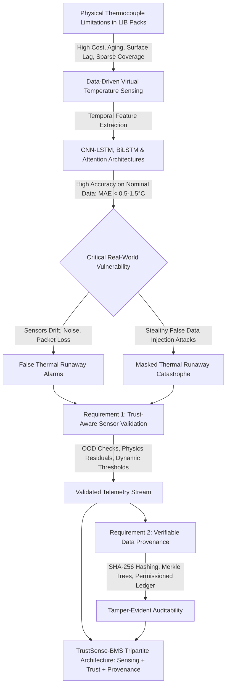

# 04 — Review Outline, Logical Argument Map, and Research Questions Alignment

## 1. Research Question to Section Mapping

| Research Question (RQ) | Primary Section | Key Argument / Synthesis Goal |
| :--- | :--- | :--- |
| **RQ1: Data-Driven Virtual Sensing Landscape** | Section III & IV | Synthesize physical thermocouple bottlenecks (harness bulk, physical degradation, surface vs core lag) and map how deep temporal estimators reconstruct internal/surface thermal dynamics. |
| **RQ2: Temporal Deep Learning Architectures** | Section IV & V | Contrast 1D-CNN feature extraction, LSTM/BiLSTM recurrence, Attention Mechanisms (AM), and Transfer Operators (DeepONet) regarding accuracy, lag, and computational footprint. |
| **RQ3: Datasets, Features & Horizons** | Section V (Table A) | Benchmark public vs proprietary datasets (Panasonic 18650PF, CALB, LG HG2), critical input vectors (V, I, Ah, T_amb, P, |I|), sequence windows (30-60 steps), and prediction horizons (1s-60s). |
| **RQ4: Methodological Gaps & Generalization** | Section V & IX | Expose critical flaws: target leakage, lack of sub-zero validation, single-cell to multi-cell pack generalization failure, and degradation-induced thermal impedance drift. |
| **RQ5: Trustworthy Telemetry & Provenance** | Section VI & VII (Table B) | Prove that virtual sensing is defenseless against sensor drift, OOD inputs, and False Data Injection Attacks (FDIA) unless paired with residual validation, Merkle-tree batching, and permissioned ledger anchors. |
| **RQ6: Dependable Real-World Deployment Roadmap** | Section VIII & IX | Synthesize the TrustSense-BMS tripartite paradigm: Virtual Sensing + In-Line Sensor Trust Validation + Off-Chain Immutable Provenance, distinguishing verified baseline results from conceptual roadmap items. |

---

## 2. Argument Flow Map

---

## 3. Section-by-Section Authoring Plan (6-Page IEEE Framework)

### Section I: Introduction (0.75 Page)
- **Problem Statement:** Thermal runaway is the leading catastrophic failure mode of high-energy lithium-ion batteries in marine and automotive applications.
- **Physical Sensing Dilemma:** Direct thermocouple placement inside cells causes manufacturing defects and seal leakage; surface thermocouples suffer from substantial thermal inertia (up to 30-60s lag) and sparse pack coverage.
- **The Promise & Hazard of Virtual Sensing:** Temporal neural networks (CNN-LSTM) accurately infer battery temperatures from electrical signals (V, I, Ah, P). However, existing literature overwhelmingly assumes *pristine, honest sensor streams*. In practice, compromised or faulty telemetry renders deep estimators dangerously misleading.
- **Review Scope & Contribution:** Structured evaluation of 32 studies bridging deep virtual thermal sensing, cybersecurity/trust validation, and verifiable data provenance.

### Section II: Review Methodology (0.5 Page)
- Search queries, PRISMA screening flow (186 identified -> 142 screened -> 32 included).
- Categorization into: (1) Direct Thermal Virtual Sensing, (2) Sensor Trust & Anomaly Validation, and (3) Data Provenance & Ledger Architectures.

### Section III: Battery Thermal Monitoring Fundamentals & Sensing Taxonomy (0.5 Page)
- Electro-thermal dynamics: Joule heating ($I^2 R$), reversible entropic heat ($I T rac{\partial U}{\partial T}$), and heat dissipation via convection/conduction.
- Sensing taxonomy: Physical in-situ vs surface thermocouples vs virtual soft sensing.

### Section IV: Deep Learning Architectures for Battery Thermal Estimation (1.0 Page)
- **1D-CNN:** Extracts local temporal feature correlations across multi-variate electrical signals.
- **LSTM / BiLSTM:** Models long-term thermal accumulation and heat dissipation dynamics without vanishing gradients.
- **Attention Mechanisms (AM):** Dynamically weights high C-rate bursts and abrupt load transients.
- **Physics-Informed Neural Networks & Operator Learning:** Enforcing conservation of energy and boundary conditions.

### Section V: Comparative Literature Analysis & Benchmarks (1.0 Page)
- **Comparative Table A:** Comprehensive synthesis of published thermal virtual sensors (datasets, chemistries, features, sequence lengths, horizons, MAE/RMSE/R² metrics, and limitations).
- **Critical Methodological Critique:** Target leakage pitfalls, single-cell bias (e.g., Panasonic 18650PF single-cell benchmarks vs battery packs), and sub-zero performance degradation.

### Section VI: Trustworthy Telemetry & Sensor Cybersecurity in BMS (0.75 Page)
- Classification of sensor corruption: hardware faults (bias, drift, freezing) vs malicious attacks (False Data Injection Attacks, Replay attacks).
- Trust-aware validation strategies: Schema bounds, Out-of-Distribution (OOD) 5-sigma detection, and physics-residual consistency checks.

### Section VII: Data Provenance & Cryptographic Auditability (0.75 Page)
- Why provenance matters: Marine safety audits, insurance investigations, warranty claims, and battery second-life certification.
- Cryptographic hashing (SHA-256) and Merkle-tree batching: reducing on-chain overhead from $O(N)$ to $O(1)$.
- Ledger architecture: Why permissioned consortia (Hyperledger Fabric) supersede public blockchains for industrial telemetry.

### Section VIII: Synthesis — A TrustSense-BMS Design Perspective (0.5 Page)
- Deriving design principles for a robust battery intelligence platform.
- Rigorous demarcation: What is experimentally verified in project baseline (CNN-LSTM on Panasonic 18650PF: MAE 1.54 °C, RMSE 2.08 °C, R² 0.974 under UDDS at -10°C) vs what represents planned cloud/blockchain architecture.

### Section IX: Open Challenges and Future Research Directions (0.5 Page)
- Cross-chemistry & cross-aging transferability.
- Embedded MCU quantization vs cloud-assisted inference latency.
- Unified benchmark datasets coupling thermal ground truth with cybersecurity attack injections.

### Section X: Conclusion (0.25 Page)
- Concluding synthesis reinforcing that virtual temperature sensing must evolve from isolated deep learning models to holistic, trust-aware, verifiable cyber-physical architectures.
